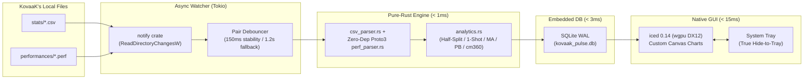

<div align="center">

# KovaaK Pulse

**极致轻量、零帧率干扰的 KovaaK's 实时监测与长期数据分析桌面小组件**  
*Lightweight, zero-overhead native Windows companion widget for real-time KovaaK's post-run analysis and long-term aim progression.*

[](https://www.rust-lang.org/)
[-60A5FA?style=flat-square)](https://iced.rs/)
[](#building--testing)
[](#architecture)
[](LICENSE)

[中文文档](#-核心亮点) · [English Overview](#-english-overview) · [系统架构](#-architecture) · [构建与测试](#-building--testing)

</div>

---

## ✨ 核心亮点

KovaaK Pulse 编译为单个原生 `.exe`（~12.5 MB，无 Python 运行时、无 Electron / Chromium 进程），专为高帧率竞技玩家打造：

| 特性 | 说明 |
| :--- | :--- |
| **380 × 560 紧凑可滚动小组件** | 类 Windows 11 日历 Flyout 尺寸的单列纵向滚动面板，极简黑白灰配色 + 严格 4 层数据主次层级，不占屏幕空间。 |
| **~215 ms 完赛自动出图** | 基于 Windows 原生 `ReadDirectoryChangesW` (`notify`) 内核监听 + `.csv`/`.perf` 双文件稳定防抖 + 纯 Rust 零依赖 Proto3 线协议解码器，端到端入库出图仅需 **~0.22 秒**。 |
| **1000+ FPS 零干扰 & 真隐藏到托盘** | 无轮询、后台空载 CPU ≈ 0%；关闭窗口真正隐藏至系统托盘（`window::Mode::Hidden`，不在任务栏残留），完赛刷新不抢游戏前台焦点。 |
| **实时双语 & 深浅主题切换** | 设置页一键切换 **中文 / English** 与 **深色 / 浅色** 主题，所有卡片、自绘 `Canvas` 图表与系统托盘菜单即时同步并持久化。 |
| **自动路径探测 & 嵌入式存储** | 自动解析 Windows 注册表与 Steam `libraryfolders.vdf` 定位 KovaaK's 目录；本地 SQLite (WAL) 去重入库，万局历史秒开。 |

---

## 📊 三大核心视图与 4 层数据层级

### 1. 单局复盘（Single-Run Review）
严格按照「核心结论 → 关键效率 → 过程诊断 → 环境元数据」四层信息权重排布：
- **Tier 1 · 核心指标卡（Hero）**：超大号总分（`Score`）+ `NEW PB` / 近 10 局均分差值 `Δ`，右侧配对显示命中率（`Accuracy %`）与 `命中/总开火`。
- **Tier 2 · 次级效率条（3-Column Strip）**：`KPS`（含峰值 KPS）、`平均 TTK`（含击杀间隔）、`一枪率 1-Shot %`（含补枪平均耗时）。
- **深度洞察 · Deep Telemetry（KovaaK's 游戏内不可见的隐藏指标）**：
  - **零失误理论上限（Zero-Miss Ceiling）**：量化多枪补射耗费的总秒数与折算损失击杀数，推算当局零失误理论最高分。
  - **最长一枪连杀 & 连空传染（Streak & Tilt Cascade）**：统计最长连续一枪秒杀（`Max 1-Shot Streak`）及连续失误传染次数（`Clustered Misses`）。
  - **反应分位数 & 节拍器波动（P10 / P50 / P90 & Rhythm CV%）**：剥离极端值干扰，展示极限爆发 `P10`、真实中位节奏 `P50`、卡壳瓶颈 `P90` 与一枪节拍变异系数 `CV%`。
  - **三段式节奏画像（3-Phase Pacing Profile）**：拆解 `前 1/3 → 中 1/3 → 后 1/3` 的 KPS 与准度变化，自动判定节奏类型（`节拍器稳定` / `开局慢热` / `中段走神` / `尾盘手紧` / `后程爆发`）。
- **Tier 3 · 自绘 `Canvas` 交互图表与稳定性诊断**：
  - **逐秒双轴图**：柱状图（支持切换 `KPS` / `得分` / `伤害效率`，负分自动标红）+ 银白色每秒命中率折线 + 悬停十字准星明细。
  - **前后半程对比卡**：自动对比 `0–50%` 与 `50–100%` 准度、KPS 与得分变化，输出稳定性诊断。
  - **击杀节奏散点图**：浅灰点标记一枪秒杀、淡红点突出多枪补射，一眼定位失误节奏与补枪延迟。
- **Tier 4 · 静默元数据底栏**：低视觉权重展示自动换算的 `cm/360`（覆盖 CS / Valorant / Overwatch / Apex / Quake / The FINALS 等 25+ 游戏灵敏度体系）、平均 FPS 与分辨率。

### 2. 长期趋势（Long-Term Trends）
- 支持按时间范围（今日 / 7 天 / 30 天 / 全部）、指标（`Score` / `Accuracy` / `KPS` / `Avg TTK` / `1-Shot %`）与均线窗口（`MA5` / `MA10` / `MA20`）筛选。
- 自绘趋势图同时叠加**单局散点 + MA 移动均线 + 历史 PB 阶梯包络线 + `cm/360` 灵敏度变更竖直标记线**，并统计**保底线 `P25`（Skill Floor）**与**常态上限 `P90`（Skill Ceiling）**。
- 下方提供按灵敏度/FOV 分组的**配置对比卡片**（局数、均值、PB、标准差 CV%），量化换灵敏度后的真实收益。

### 3. 训练总览（Training Overview）
- **18 周 GitHub 风格训练热力图**：直观呈现每日训练强度，悬停查看当日局数、时长与新纪录。
- **今日训练统计 + 可点击近期 PB 列表**：点击任意 PB 直接跳转至该局复盘。
- **一键导出 CSV**：将当前项目的完整历史数据导出为标准 CSV 文件。

---

## 🏗 Architecture



---

## 📡 Telemetry Data Sources & Derived Metrics

| Data Source | Fields Extracted |
| :--- | :--- |
| **`Stats.csv`** | Per-kill events (`Kill #`, `Timestamp`, `Bot`, `Weapon`, `TTK`, `Shots`, `Hits`, `Damage Done/Possible`, `OverShots`), weapon summary, run totals (`Score`, `Kills`, `Deaths`, `Avg TTK`, `Reloads`, `MBS Points`, `Distance Traveled`), and hardware/sensitivity settings (`Sens Scale`, `Horiz/Vert Sens`, `DPI`, `FOV`, `Resolution`, `Avg FPS`). |
| **`Performance.perf`** | Zero-dependency **Proto3 wire-format** decoder reading `Header` (`scenario_name`, `scenario_hash`, `challenge_start_utc`, `ScenarioConfig`) and 1 Hz `Events` stream (`shots_fired`, `shots_hit`, `shots_missed`, `damage_done`, `score`, `kills`, `overshots`, `target_size`, `target_speed`, `random_sens_scale`), cross-validated against CSV totals. |
| **Derived Metrics** | Automatic **`cm/360`** conversion across 25+ games, **`1-Shot %`**, **Zero-Miss Theoretical Ceiling Score**, **Max 1-Shot Streak & Tilt Cascade count**, **P10 / P50 / P90 kill interval percentiles & Rhythm CV%**, **3-Phase Pacing Profile (`Early / Mid / Late`)**, **worst score-drop & peak KPS seconds**, **first-half vs. second-half stability diagnosis**, **MA5/MA10/MA20**, **PB step envelope**, **Skill Floor `P25` / Ceiling `P90`**, and **`cm/360` change attribution**. |

---

## 📁 Project Structure

```text
KovaaK-Pulse/
├── assets/
│   └── icon.ico                 # Multi-size (16/32/64) embedded Windows executable icon
├── build.rs                     # Windows resource & icon embedding via winresource
├── Cargo.toml                   # Rust Edition 2024 manifest & release LTO profile
├── src/
│   ├── main.rs                  # iced 0.14 (wgpu) entry point, 380x560 window & icon setup
│   ├── lib.rs                   # Core library exports
│   ├── model.rs                 # Core domain models, Language/ThemeMode & AppConfig
│   ├── config.rs                # Steam/Registry auto-detection & JSON config persistence
│   ├── analytics.rs             # Half-split diagnostics, MA, PB envelope & config grouping
│   ├── watcher.rs               # notify + Tokio paired .csv/.perf debounced watcher
│   ├── parser/
│   │   ├── csv_parser.rs        # KovaaK's Stats.csv parser & cm/360 converter
│   │   └── perf_parser.rs       # Zero-dependency Proto3 wire decoder for .perf files
│   ├── storage/
│   │   └── db.rs                # SQLite (WAL) schema, deduplication & incremental sync
│   └── ui/
│       ├── app.rs               # MVU state machine, 4-tier views & true hide-to-tray
│       ├── theme.rs             # Minimalist monochrome Dark & Light UiPalette
│       ├── i18n.rs              # Full Zh / En localization helpers
│       ├── sidebar.rs           # Compact top scenario picker & collapsible dropdown
│       ├── tray.rs              # System tray controller & shared reticle RGBA renderer
│       └── charts/              # Custom Canvas charts (per-second, kill scatter, trend, heatmap)
└── tests/
    ├── fixtures/                # Real KovaaK's .csv + .perf test fixtures
    ├── parser_tests.rs          # Exact telemetry, fallback & cm/360 assertions
    ├── analytics_tests.rs       # Deduplication, PB step, MA & heatmap tests
    └── watcher_latency.rs       # Sub-second end-to-end file-watch latency test (~215ms)
```

---

## 🛠 Building & Testing

### Prerequisites
- **Windows 10 / 11 (x64)**
- **Rust (`x86_64-pc-windows-msvc`, Rust 1.85+ / Edition 2024)**
- **Visual Studio 2022 C++ Build Tools** + **Windows 10/11 SDK**

### Commands

```powershell
# Run full unit & integration test suite (including ~215ms E2E watcher latency test)
cargo test -- --nocapture

# Build standalone optimized release binary (thin LTO + stripped)
cargo build --release
```

The standalone executable is generated at `target\release\kovaak-pulse.exe` (~12.5 MB).

---

## 🌐 English Overview

**KovaaK Pulse** is a compact (`380 × 560` vertically scrollable) native Windows desktop widget written in **Rust** and **iced 0.14 (`wgpu`)** for **KovaaK's** aim trainer.

- **Instant Post-Run Feedback (~215 ms)**: Watches `stats/*.csv` and `performances/*.perf` using Windows `ReadDirectoryChangesW` with paired debouncing and a zero-dependency Proto3 `.perf` decoder, persisting runs to an embedded SQLite (WAL) database.
- **Zero In-Game Interference**: Compiles to a single native binary with ~0% idle CPU, true hide-to-tray (`window::Mode::Hidden`), and non-intrusive background refresh that never steals focus during gameplay.
- **Minimalist 4-Tier UI**: Features a disciplined monochrome Dark & Light theme, instant **English / 中文** switching across UI and system tray, per-second dual-axis charts, kill-pacing scatter plots, half-split stability diagnostics, long-term MA/PB trend curves with `cm/360` change attribution, and an 18-week activity heatmap.

---

## 📄 License

Distributed under the terms of the [LICENSE](LICENSE) file in this repository.
