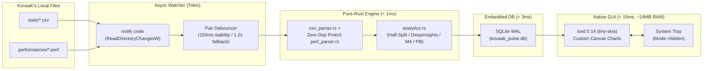

<div align="center">

# KovaaK Pulse

KovaaK's 本地数据实时监听与长期统计桌面小组件（Windows 原生单文件 GUI）。

[](https://www.rust-lang.org/)
[-60A5FA?style=flat-square)](https://iced.rs/)
[](#视图与功能)
[](#构建与测试)
[](#系统架构)
[](LICENSE)

[视图与功能](#视图与功能) · [系统架构](#系统架构) · [数据来源与派生指标](#数据来源与派生指标) · [目录结构](#目录结构) · [构建与测试](#构建与测试)

</div>

---

## 视图与功能

### 运行特性
- **尺寸与布局**：`380 × 560` 单列纵向可滚动窗口，黑白灰双色主题（Dark / Light）与中英双语（`中文 / EN`）实时切换。
- **实时监听**：通过 Windows `ReadDirectoryChangesW` (`notify`) 监听 `stats/*.csv` 与 `performances/*.perf`，双文件配对防抖 + Proto3 解码 + SQLite (WAL) 入库耗时约 `215 ms`。
- **资源占用**：单文件 `.exe` 约 `7.0 MB`；工作集内存约 `24 MB`（私有内存约 `8 MB`）；事件驱动托盘订阅与 Win32 工作集裁剪，空闲 CPU 占用 `0.00%`。
- **系统托盘**：关闭窗口隐藏至系统托盘（`window::Mode::Hidden`），后台刷新不抢前台焦点。

### 单局复盘
- **核心与次级指标**：总分（`Score`）、`NEW PB` / 近 10 局均分差值 `Δ`、命中率（`Accuracy %`）、`KPS`（含峰值）、平均 `TTK`、一枪率（`1-Shot %`）与补枪平均耗时。
- **深度洞察（Deep Telemetry）**：
  - **零失误理论上限（Zero-Miss Ceiling）**：基于多枪补射总耗时与中位一枪间隔，折算损失击杀数与理论零失误得分。
  - **最长一枪连杀与连空传染**：统计单局最长连续一枪击杀数（`Max 1-Shot Streak`）与连续多枪失误次数（`Clustered Misses`）。
  - **反应分位数与节拍波动**：输出击杀间隔 `P10`（爆发）、`P50`（中位）、`P90`（卡壳）分位数及一枪间隔变异系数 `CV%`。
  - **三段式节奏画像（3-Phase Pacing）**：对比前 1/3、中 1/3、后 1/3 的 KPS 与命中率，分类为 `节拍器稳定`、`开局慢热`、`中段走神`、`尾盘手紧` 或 `后程爆发`。
- **交互图表与元数据**：
  - **逐秒表现双轴图**：柱状图（`KPS` / `得分` / `伤害效率`）+ 每秒命中率折线 + 悬停明细。
  - **前后半程对比与击杀间隔散点图**：对比 `0–50%` 与 `50–100%` 表现，散点区分一枪击杀与多枪补射。
  - **底栏环境信息**：自动换算 `cm/360`（支持 CS、Valorant、Overwatch、Apex、Quake、The FINALS 等 25+ 游戏灵敏度配置）、平均 FPS 与分辨率。

### 长期趋势
- 支持按时间范围（今日 / 7 天 / 30 天 / 全部）、指标（`Score` / `Accuracy` / `KPS` / `Avg TTK` / `1-Shot %`）与移动均线窗口（`MA5` / `MA10` / `MA20`）过滤。
- 趋势图叠加单局散点、MA 均线、历史 PB 阶梯线及 `cm/360` 灵敏度变更标记线，并统计保底线 `P25` 与常态上限 `P90`。
- 按 `cm/360 · FOV` 自动分组对比不同配置下的局数、均值、PB 与标准差。

### 训练总览
- 18 周每日训练局数热力图、今日训练汇总、近期 PB 列表（点击跳转对应单局复盘）及单项目历史 CSV 导出。

---

## 系统架构



---

## 数据来源与派生指标

| 数据源 | 提取与计算字段 |
| :--- | :--- |
| **`Stats.csv`** | 逐杀事件（`Kill #`, `Timestamp`, `Bot`, `Weapon`, `TTK`, `Shots`, `Hits`, `Damage Done/Possible`, `OverShots`）、武器汇总、对局总计（`Score`, `Kills`, `Deaths`, `Avg TTK`, `Reloads`, `MBS Points`, `Distance Traveled`）及灵敏度与硬件设置（`Sens Scale`, `Horiz/Vert Sens`, `DPI`, `FOV`, `Resolution`, `Avg FPS`）。 |
| **`Performance.perf`** | 零依赖 Proto3 线协议解码器读取 `Header`（`scenario_name`, `scenario_hash`, `challenge_start_utc`, `ScenarioConfig`）与 1 Hz `Events` 序列（`shots_fired`, `shots_hit`, `shots_missed`, `damage_done`, `score`, `kills`, `overshots`, `target_size`, `target_speed`, `random_sens_scale`），并与 CSV 总计交叉校验。 |
| **派生指标** | `cm/360` 跨游戏换算、一枪率（`1-Shot %`）、零失误理论上限（`Zero-Miss Ceiling`）、最长一枪连杀与连空传染、击杀间隔 `P10/P50/P90` 与节拍 `CV%`、三段式节奏画像、前后半程对比、`MA5/MA10/MA20`、PB 阶梯线、`P25/P90` 分位线及灵敏度变更分组归因。 |

---

## 目录结构

```text
KovaaK-Pulse/
├── assets/
│   └── icon.ico                 # 16/32/64 多尺寸程序图标
├── build.rs                     # Windows 可执行文件资源与图标嵌入
├── Cargo.toml                   # Rust Edition 2024 配置与 Release LTO 编译参数
├── src/
│   ├── main.rs                  # iced 0.14 (tiny-skia) 入口、380x560 窗口与图标初始化
│   ├── lib.rs                   # 核心库导出
│   ├── model.rs                 # 数据结构、DeepInsights、Language/ThemeMode 与 AppConfig
│   ├── config.rs                # Steam 注册表/VDF 路径自动探测与 JSON 配置读写
│   ├── analytics.rs             # 前后半程诊断、深度洞察、MA、PB 阶梯与配置分组计算
│   ├── watcher.rs               # notify + Tokio 双文件配对防抖监听器
│   ├── parser/
│   │   ├── csv_parser.rs        # Stats.csv 解析器与 cm/360 换算
│   │   └── perf_parser.rs       # 零依赖 Proto3 .perf 线协议解码器
│   ├── storage/
│   │   └── db.rs                # SQLite (WAL) 存储、去重入库与增量同步
│   └── ui/
│       ├── app.rs               # 状态机、视图布局、托盘隐藏与工作集裁剪
│       ├── theme.rs             # Dark / Light 调色板与组件样式
│       ├── i18n.rs              # 中文 / English 文案与诊断格式化
│       ├── sidebar.rs           # 顶部项目选择器与折叠搜索下拉列表
│       ├── tray.rs              # 系统托盘控制与图标 RGBA 生成
│       └── charts/              # Canvas 图表（逐秒双轴、击杀散点、长期趋势、热力图）
└── tests/
    ├── fixtures/                # 真实 KovaaK's .csv + .perf 测试样本
    ├── parser_tests.rs          # 解析精度、降级路径与 cm/360 测试
    ├── analytics_tests.rs       # 去重、PB 阶梯、MA、深度洞察与热力图测试
    └── watcher_latency.rs       # 端到端文件监听延迟测试 (~215ms)
```

---

## 构建与测试

### 环境要求
- Windows 10 / 11 (x64)
- Rust (`x86_64-pc-windows-msvc`, Rust 1.85+ / Edition 2024)
- Visual Studio 2022 C++ Build Tools + Windows 10/11 SDK

### 常用命令

```powershell
# 运行单元测试与集成测试
cargo test -- --nocapture

# 编译 Release 单文件可执行程序
cargo build --release
```

编译产物位于 `target\release\kovaak-pulse.exe`。

---

## License

遵循仓库根目录 [LICENSE](LICENSE) 文件中的条款发布。
